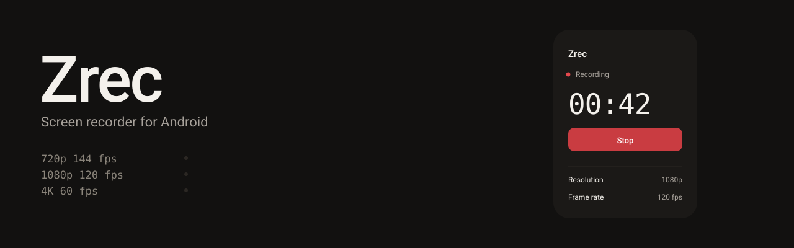

<p align="center">
  <a href="https://github.com/Zdevlops/zrec/releases/latest">
    
  </a>
</p>

Screen recorder Android tanpa iklan, tanpa watermark, dan tanpa akun. Dibuat native dengan Kotlin dan framework Android saja, jadi APK-nya di bawah 100 KB.

Satu file, tidak ada tambahan lain. Ambil di [Releases](../../releases/latest).

> [!WARNING]
> **MAKS FPS TETAP BERGANTUNG KEMAMPUAN ASLI DEVICE.**
> Angka di bawah itu batas atas dari Zrec, bukan janji. Kalau encoder HP cuma sanggup 1080p60, ya 60 fps yang muncul dan yang terekam. Zrec membaca kemampuan encoder lewat `MediaCodecList`, jadi yang ditawarkan hanya yang benar-benar bisa dijalankan.

## Features

| Feature | Description |
|---|---|
| **Screen recording** | MediaProjection langsung ke hardware encoder, tanpa re-encode |
| **Floating control** | Bola yang bisa digeser di luar aplikasi: record, stop, pause, screenshot |
| **Close by drag** | Geser bola ke target di tengah bawah untuk menutupnya, tanpa masuk ke aplikasi |
| **Hide while recording** | Bola hilang otomatis supaya hasil rekaman bersih |
| **Summon by volume** | Tekan volume bawah dua kali untuk memunculkan bola lagi selama 5 detik |
| **Shake to stop** | Goyang dua kali saat merekam |
| **Screenshot** | Bisa saat merekam atau tanpa merekam, tersimpan ke `Pictures/Zrec` |
| **Audio** | Off, Mic, Internal, atau Mic + internal |
| **Rotation handling** | Rekaman dipecah ke file baru saat layar diputar, jadi tidak ada video miring |
| **Honest options** | Resolusi dan frame rate difilter dari kemampuan encoder HP, bukan daftar karangan |

Hasil rekaman masuk ke `Movies/Zrec`, screenshot ke `Pictures/Zrec`.

## Quality limits

Frame rate dibatasi per resolusi supaya file tidak meledak dan encoder tidak tersendat. Batas HP tetap berlaku dan selalu menang.

| Resolution | Max frame rate |
|---|---|
| 720p | 144 fps |
| 1080p | 120 fps |
| 1440p | 90 fps |
| 4K | 60 fps |

Resolusi terendah 720p. Di bawah itu teks di layar berhenti terbaca setelah dikompres.

## Auto update

Zrec memeriksa rilis baru setiap kali dibuka. Kalau ada yang lebih baru, muncul baris **Version x.y.z available** di atas tombol rekam. Tap **Update**, APK diunduh, lalu installer Android terbuka.

Android tidak mengizinkan aplikasi sideload memasang pembaruan tanpa konfirmasi. Jadi satu tap tetap diperlukan. Itu batas sistem, bukan pilihan Zrec.

Butuh versi tanpa jaringan sama sekali? Pakai [Zrec lite](https://github.com/Zdevlops/zrec-lite).

## Permissions

- **Screen capture** — dialog bawaan Android, muncul setiap kali mulai merekam.
- **Microphone** — hanya kalau audio disetel ke Mic atau Mic + internal.
- **Display over other apps** — hanya kalau floating control dinyalakan.
- **Notifications** — untuk kontrol rekam saat bola sedang disembunyikan.

- **Install unknown apps** — hanya diminta saat kamu menekan Update, supaya Android mau memasang APK baru.

Jaringan dipakai untuk satu hal saja: menanyakan rilis terbaru ke GitHub. Tidak ada analytics, tidak ada akun, tidak ada data yang dikirim.

## Verifikasi unduhan

Setiap APK punya SHA-256 yang dicantumkan di halaman release. Cocokkan sebelum memasang:

```powershell
# Windows
Get-FileHash Zrec-1.0.0.apk -Algorithm SHA256
```

```bash
# Termux / Linux
sha256sum Zrec-1.0.0.apk
```

Rilis terakhir:

| File | Ukuran | SHA-256 |
|---|---|---|
| `Zrec-1.0.0.apk` | 78.685 byte | `dcb9327695a94e01c6ec1134e05549e7e19479d3c0f94bd8f487c9536b154b43` |

File `.sha256` juga ikut diunggah di setiap release, isinya satu baris siap dipakai `sha256sum -c`.

## Build

Butuh JDK 17 dan Android SDK. Tidak perlu Android Studio.

```bash
git clone https://github.com/Zdevlops/zrec.git
cd zrec
gradle assembleRelease
```

APK keluar di `app/build/outputs/apk/release/app-release.apk`.

Build lokal menghasilkan APK **tanpa tanda tangan**. Kunci rilis tidak ada di repo; CI menyimpannya sebagai secret dan menyuntikkannya saat build. Jadi kalau mau memasang hasil build sendiri, tandatangani dulu dengan keystore milik sendiri.

Repo ini juga punya GitHub Actions: setiap push ke `main` menghasilkan APK sebagai artifact, dan setiap tag `v*` menerbitkan release berisi APK saja.

## Structure

```
app/src/main/java/com/zrec/recorder/
  MainActivity.kt      layar utama dan pengaturan
  RecorderService.kt   foreground service, notifikasi, guncangan, rotasi
  ScreenRecorder.kt    MediaCodec + MediaMuxer, audio, jeda
  OverlayService.kt    floating control
  Shot.kt              screenshot sekali jalan
  Caps.kt              pembacaan kemampuan encoder
  Updater.kt           cek rilis, unduh APK, buka installer
  ApkProvider.kt       penyaji file APK ke installer
  Config.kt            preferensi
```

## Known limits

- Floating control tidak bisa terlihat di layar tapi hilang dari rekaman. Android tidak menyediakan itu. Karena itu bola disembunyikan selama merekam, dan kontrol pindah ke notifikasi.
- Memanggil bola dengan volume bawah 2x hanya bekerja kalau volume benar-benar turun. Kalau media sudah di angka 0, tidak ada perubahan yang bisa dideteksi. Kontrol rekam tetap ada di notifikasi, dan bola muncul sendiri begitu rekaman selesai.
- Audio internal bisa kosong di aplikasi yang melarang perekaman suaranya. Ini keputusan aplikasi tersebut, bukan bug Zrec.
- Kalau "Hide while recording" dimatikan, bola ikut terekam.
- Rotasi di tengah rekaman menghasilkan dua file, bukan satu file yang berputar.

## License

[MIT](LICENSE). Pakai, ubah, dan bagikan bebas.
